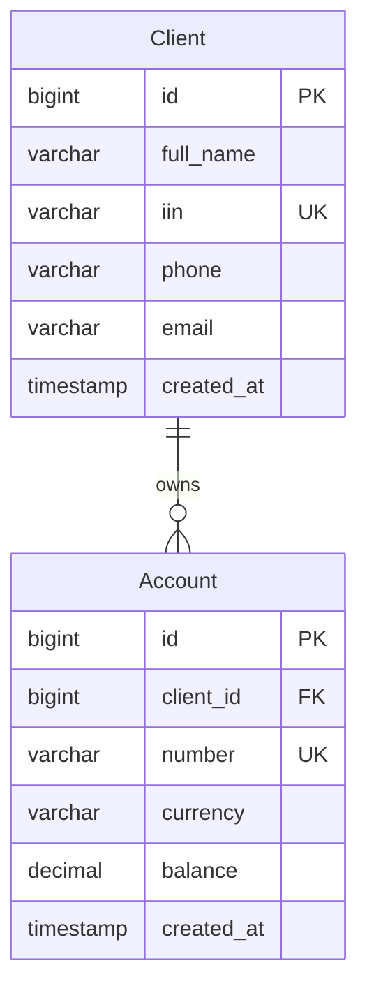

# Лабки 4 — банковские клиенты и счета

Учебное приложение: **Django REST Framework + PostgreSQL + JWT**.
Русский интерфейс с таблицами, авторизацией, поиском, созданием, изменением и удалением записей. Все кнопки работают через HTTP API с настоящей базой PostgreSQL.

> GitHub хранит код и запускает тесты. Сам Django-сервер запускается на компьютере: GitHub Pages не запускает Python/PostgreSQL. В проекте нет настоящих банковских данных и заранее заданного пароля пользователя.

## Что выполнено с доски

| Требование | Реализация |
|---|---|
| Архитектура базы, таблицы | `Client` и `Account`, связь один-ко-многим |
| GET, POST, PUT, DELETE для каждой таблицы | `/api/clients/`, `/api/accounts/`, маршруты `/<id>/` |
| Авторизация, JWT-токен | `/api/auth/token/`, `/api/auth/refresh/`, Bearer |
| Body (JSON) | Создание и изменение через JSON |
| Query | `?search=`, `?ordering=`, для счетов `?client=&currency=` |
| Табличное представление | Главная страница `/`, дополнительно Django Admin |
| SQL-база | PostgreSQL, миграции и SQL-файл `docs/schema.sql` |

## Быстрый запуск на Windows (PowerShell)

Требуется Python 3.12 и PostgreSQL. Открой папку проекта в VS Code → Terminal.

```powershell
git clone https://github.com/isabayerasil13-droid/labki-4.git
cd labki-4
py -3.12 -m venv .venv
.\.venv\Scripts\python.exe -m pip install -r requirements.txt
Copy-Item .env.example .env
```

### 1. Подготовить PostgreSQL — выбери один способ

**Если PostgreSQL уже установлен:** открой pgAdmin → сервер → база `postgres` → Query Tool. Выполни эти команды по отдельности (CREATE DATABASE нельзя выполнять внутри транзакции):

```sql
CREATE USER bank WITH PASSWORD 'bank_local_demo';
CREATE DATABASE bank_lab4 OWNER bank;
```

Пароль в примере только для локальной учебной базы. При замене пароля измени `DATABASE_URL` в `.env`. Если пароль содержит `@`, `:`, `/` и другие специальные символы, закодируй их для URL.

**Если используешь Docker Desktop:** вместо предыдущих SQL-команд выполни:

```powershell
docker compose up -d --wait
```

Не запускай оба способа одновременно на порту 5432.

### 2. Настроить и запустить приложение

Открой `.env`, замени `DJANGO_SECRET_KEY` своей случайной строкой. Её можно получить командой:

```powershell
.\.venv\Scripts\python.exe -c "from django.core.management.utils import get_random_secret_key; print(get_random_secret_key())"
```

Затем:

```powershell
.\.venv\Scripts\python.exe manage.py migrate
.\.venv\Scripts\python.exe manage.py createsuperuser
.\.venv\Scripts\python.exe manage.py seed_demo
.\.venv\Scripts\python.exe manage.py runserver
```

Создай свой логин и пароль через `createsuperuser` (при вводе пароля символы не отображаются).
Открой **http://127.0.0.1:8000/** и войди. Админка: **http://127.0.0.1:8000/admin/**.
Данные хранятся в PostgreSQL после перезапуска; `seed_demo` можно запускать повторно без дублей.
На Linux/macOS: `python3 -m venv .venv`, затем `.venv/bin/python` вместо `.\.venv\Scripts\python.exe`.

## Архитектура



Один клиент имеет несколько счетов. ИИН — строка из 12 цифр, чтобы сохранять начальные нули. Номер счёта — строка `KZ` + 18 символов. Это **учебная проверка формата**, без проверки контрольной суммы ИИН/IBAN. Денежные суммы — `Decimal`, а не неточный `float`. Баланс неотрицателен; ограничение есть и в базе. Удаление клиента со счетами запрещено: сначала удалить счета.

Таблицы `auth_*`, `django_*`, `token_blacklist_*` создаются Django для пользователей, сессий и JWT. CRUD требуется для предметных таблиц `bank_client` и `bank_account`; служебные таблицы напрямую через API не открыты. Все авторизованные пользователи имеют доступ к общей учебной базе (роли операторов отдельно не моделируются).

## API

| Метод | URL | Назначение |
|---|---|---|
| POST | `/api/auth/token/` | Логин → access и refresh |
| POST | `/api/auth/refresh/` | Обновление access по refresh |
| POST | `/api/auth/logout/` | Отзыв refresh |
| GET / POST | `/api/clients/` | Список / создание клиента |
| GET / PUT / PATCH / DELETE | `/api/clients/1/` | Один клиент / замена / частичная правка / удаление |
| GET / POST | `/api/accounts/` | Список / создание счёта |
| GET / PUT / PATCH / DELETE | `/api/accounts/1/` | Один счёт / замена / частичная правка / удаление |

POST/PUT/PATCH: `Content-Type: application/json`. Защищённые запросы: `Authorization: Bearer <access>`.
Access действует 15 минут, refresh — сутки. При обновлении refresh ротируется, предыдущий отзывается. Выход отзывает refresh и очищает память вкладки; ранее выданный access действует до истечения 15 минут. После перезагрузки страницы нужен новый вход: токены не сохраняются в localStorage.

**Query** находится в адресе: `/api/accounts/?client=1&currency=KZT&ordering=-balance`.
**Body** — JSON с полями записи, например:

```json
{"full_name":"Учебный Клиент","iin":"000000000010","phone":"","email":"demo@example.com"}
```

```json
{"client":1,"number":"KZ000000000000000010","currency":"KZT","balance":"15000.50"}
```

## Показ преподавателю за 5–7 минут

1. Открой этот GitHub: покажи архитектуру выше и `bank/models.py`.
2. Открой приложение, войди: вход отправляет POST и получает JWT.
3. Создай клиента, найди его поиском, измени и сохрани: POST → GET → PUT.
4. Создай счёт для клиента. Покажи связь, баланс и валюту.
5. Попробуй удалить клиента со счётом — получишь 409. Удали счёт, затем клиента — DELETE 204.
6. Для каждого шага открой «Последний запрос API» или DevTools → Network, где видны HTTP-метод, URL, JSON и ответ. После сохранения интерфейс также выполняет GET для обновления таблицы, поэтому последним в журнале будет GET; запрос изменения смотри в Network/Postman.
7. В pgAdmin: `bank_lab4 → Schemas → public → Tables → bank_client → View/Edit Data → All Rows`. Покажи `bank_account` аналогично. Записи совпадают с приложением.
8. Импортируй `docs/postman_collection.json` в Postman, выполни Login, затем GET/POST/PUT/DELETE. Подробности в `docs/POSTMAN.md`.

Короткое объяснение: «Я сделал банковский REST API. Django принимает HTTP-запрос, JWT проверяет вход, сериализатор проверяет JSON, ORM читает или изменяет таблицы PostgreSQL. Интерфейс показывает ответ в виде таблицы. У клиента может быть несколько счетов».

## Где смотреть код

| Файл | За что отвечает |
|---|---|
| `bank/models.py` | Таблицы, поля, связь и ограничения |
| `bank/serializers.py` | Преобразование JSON и проверка данных |
| `bank/views.py` | CRUD, фильтры и запрет удаления клиента со счетами |
| `config/urls.py` | Адреса API и JWT |
| `config/settings.py` | PostgreSQL, JWTAuthentication, IsAuthenticated |
| `templates/index.html`, `static/app.js` | Таблица, формы, запросы fetch |
| `bank/migrations/0001_initial.py` | Создание предметных таблиц |
| `bank/tests.py` | Проверки авторизации, CRUD, ошибок, refresh и logout |

## Ошибки и проверки

- 200 — запрос успешен; 201 — создано; 204 — удалено (тела ответа нет).
- 400 — некорректный JSON/ИИН/валюта/баланс, дубликат ИИН/номера или несуществующий клиент.
- 401 — нет токена, неверный пароль или токен истёк.
- 404 — запись не найдена; 405 — метод не разрешён; 409 — у клиента есть счета.
- 429 — слишком много неавторизованных запросов (30/мин для локальной учебной защиты).
- `connection refused` — PostgreSQL не запущен либо неверный порт.
- `password authentication failed` — пароль базы не совпадает с `.env`.
- `relation does not exist` — выполни `manage.py migrate`.

GitHub Actions автоматически запускает тесты на PostgreSQL 17 при каждом push. Результат — вкладка **Actions**. Для локальных тестов роль должна иметь CREATEDB (только локальная учебная база: `ALTER USER bank CREATEDB;` от администратора), затем:

```powershell
.\.venv\Scripts\python.exe manage.py test -v 2
```

`.env` и реальные данные не публикуются. Это учебная демонстрация, не платёжная система; `runserver` предназначен для локального показа.
